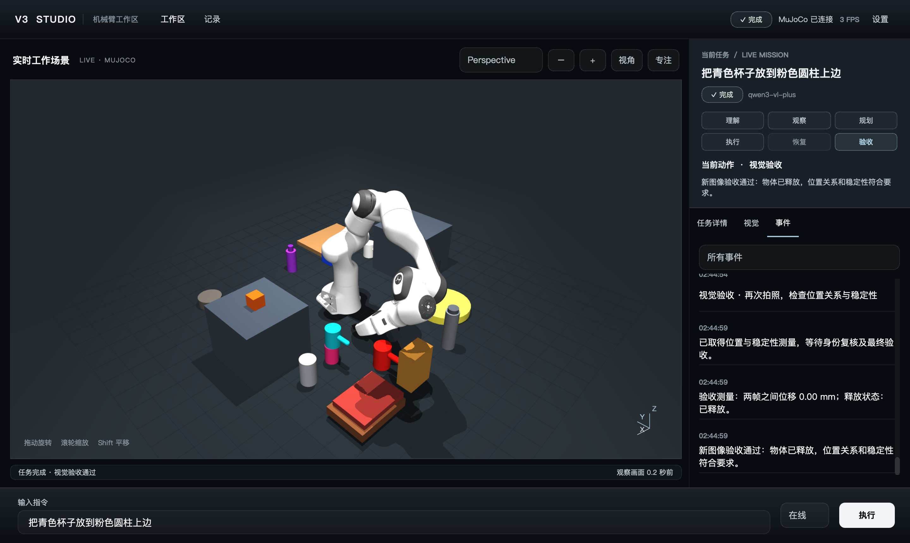
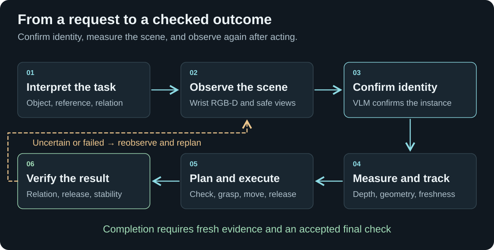
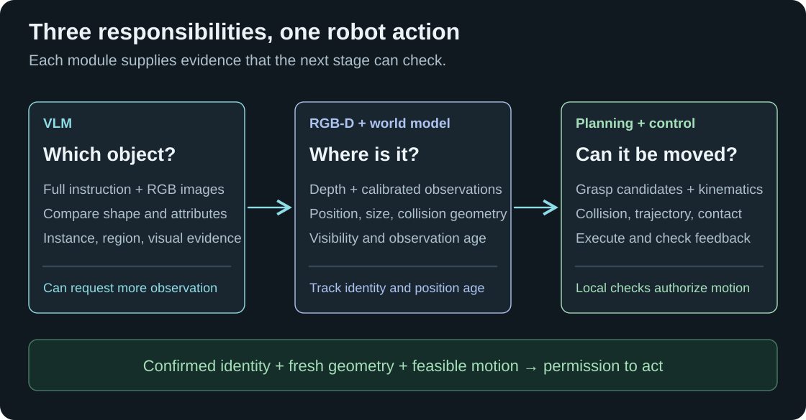
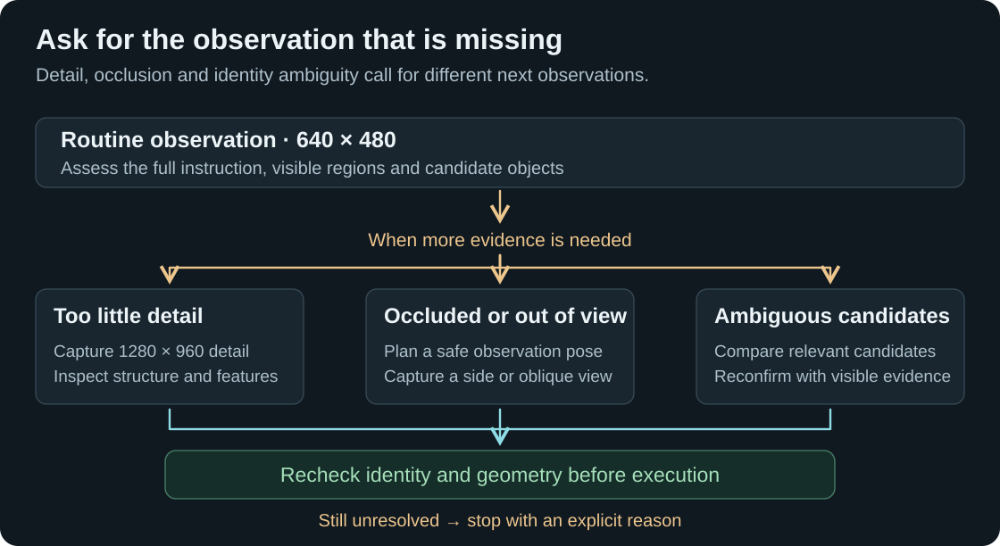
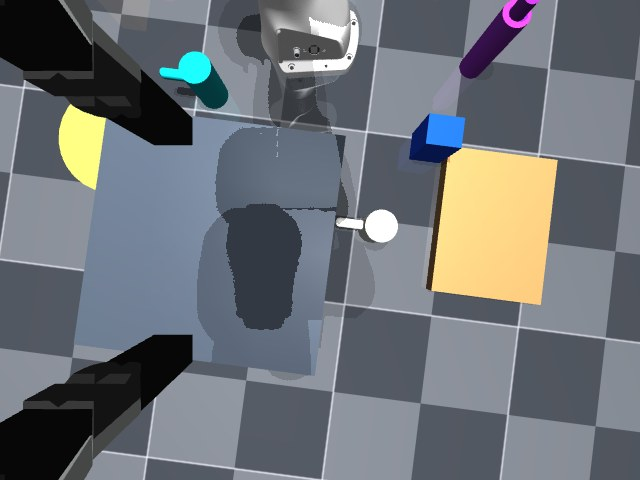
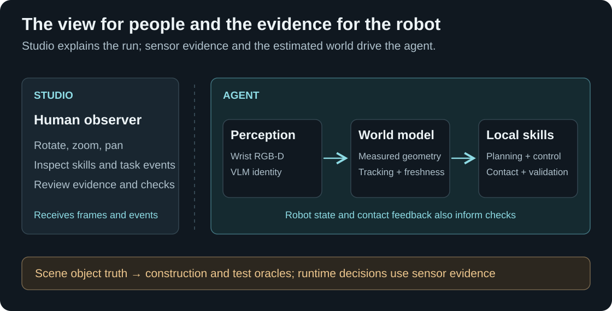

# V3 Studio · A robot that sees, acts, and checks

**Give a simulated Franka Panda a tabletop task. V3 confirms the objects from camera images, plans a feasible action, and checks the result after release.** The entire loop runs in MuJoCo and can be inspected in a local Studio.

[中文介绍](README.zh-CN.md) · [System and source map](docs/v3-system.md) · [Validation record](docs/demo-validation.json) · [Earlier V2](https://github.com/yejiasong1-ferrari/embodied-agent-v2)

> **One-sentence demo** — “Place the cyan cup on the pink cylinder.” → confirm both objects → measure and plan → grasp and place → release, retreat, and verify.

## Watch two recorded tasks

These are **actual Studio screen recordings** of V3 using an online VLM and MuJoCo physics. Each task has a **2× version below** and an expandable **1× original-speed version**. The robot's original execution time is reported separately from video playback time.

### 01 · Place the blue box to the right of the green block

V3 confirms both objects from wrist-camera images, grasps the box, and plans its transport. A blocked route triggers one recovery before the robot places the box and checks the right-of relation, release, and stability.

**Recorded result:** one grasp · one route recovery · approximately **204 s** of execution · final validation passed.

**2× playback · 1:44**

https://github.com/user-attachments/assets/dd9d4419-6911-4701-ab26-f4b7129a0d33

<details>
<summary><strong>Watch at original speed (1×) · 3:28</strong></summary>

https://github.com/user-attachments/assets/b782b579-5589-4119-bb44-b13eb619afcb

</details>

### 02 · Place the pink cylinder on the red cup

V3 adds a side view to clarify the cylinder's shape, confirms the red cup, then grasps, transports, and stacks the cylinder. After release and retreat, a fresh observation checks that it remains on the cup.

**Recorded result:** one grasp · zero failure recoveries · approximately **145 s** of execution · final validation passed.

**2× playback · 1:15**

https://github.com/user-attachments/assets/76b157b4-c193-40ee-99eb-f71049a145ae

<details>
<summary><strong>Watch at original speed (1×) · 2:29</strong></summary>

https://github.com/user-attachments/assets/ae37afeb-73cc-4bc1-8ff4-6af90629ae34

</details>

[Selected run records and video details](docs/recorded-demos.json) · [All four video versions](https://github.com/yejiasong1-ferrari/embodied-agent-v3/issues/1)

Only the unrelated stop-recording system overlay after each successful result was removed. The observation, planning, recovery, manipulation, and final-check stages remain in sequence; the footer identifies playback speed. Original video metadata was removed.

<details>
<summary><strong>Earlier example: cyan cup on a pink cylinder</strong></summary>



This frame comes from **V3 Studio executing the actual agent with an online multimodal model and MuJoCo physics**. The task completed with one grasp, zero recovery attempts, and an accepted final check in approximately 319 seconds. The [validation record](docs/demo-validation.json) documents that single run. Aggregate task success remains unmeasured.

</details>

The central V3 change is **mandatory visual confirmation of object identity**. Building on V2's manipulation loop, V3 requires image evidence for the source object and every physical reference before the corresponding action can proceed.

## Follow the task from words to a checked result

<picture>
  <source media="(max-width: 860px)" srcset="docs/images/v3-closed-loop-compact.svg">
  
</picture>

**Understand the request.** The interpreter separates the instruction into the object to move, the reference objects, the desired spatial relation, and explicit constraints. In the example, the cyan cup is the source, the pink cylinder is the support, and “on” becomes a geometric condition for placement and final validation.

**Establish visual identity and measured geometry.** The wrist camera supplies RGB, depth, and calibration. A vision-language model, or **VLM**, uses the full instruction and images to confirm the requested instances. Depth processing estimates their locations and shapes. The world model keeps identity evidence, current visibility, and measurement freshness as separate pieces of state.

**Execute with feedback.** Local code proposes grasps and placement regions, solves inverse kinematics, checks collisions, and validates trajectories. The fingers close, bilateral contact is checked, and a small probe lift tests whether the object follows. Transport and release continue under motion and contact checks.

**Observe again before completion.** The arm releases and retreats so the camera can inspect the result. Fresh observations must support the requested spatial relation, release state, and stability. Failed checks can trigger another observation or a permitted recovery action within the task budget.

## Understand who makes each decision

<picture>
  <source media="(max-width: 860px)" srcset="docs/images/v3-decision-roles-compact.svg">
  
</picture>

The VLM supplies the **semantic decision** about which instance the user means, with an image region and visible evidence. Color and depth can propose candidates and support tracking. Explicit attribute conflicts can reject a proposed identity, and local candidates alone cannot grant strict V3 identity authorization.

RGB-D processing supplies **measured geometry**. The planner and controller use that geometry to decide how the robot can approach, hold, move, and release the object. Where model-assisted strategy selection is used, the model selects from permitted choices. Local collision, contact, and validation checks still apply.

This division makes the run inspectable. A failure can be traced to uncertain identity, stale measurement, an infeasible grasp or route, contact loss, or a rejected final result.

## See how V3 handles an unclear view

<picture>
  <source media="(max-width: 860px)" srcset="docs/images/v3-active-observation-compact.svg">
  
</picture>

Higher resolution helps with small visible features. A new viewpoint helps expose a hidden side or distinguish an occluder from the object itself. Candidate comparison asks the model to apply the instruction consistently across relevant alternatives. V3 uses these observations to build more evidence and can stop with an explicit reason when it remains unresolved.

<details>
<summary><strong>Open an actual wrist-camera view from the demonstrated task</strong></summary>



This is the original 640 × 480 RGB image from a visual identity request in the demonstrated task. It shows the robot's camera view at that moment. The final Studio screenshot above shows the later outcome from the human observer camera. [Corresponding 1280 × 960 detail capture](docs/media/wrist-detail.jpg).

</details>

## Inspect the run in Studio

<picture>
  <source media="(max-width: 860px)" srcset="docs/images/v3-data-boundaries-compact.svg">
  
</picture>

Drag to rotate the scene, scroll to zoom, and Shift-drag to pan. The inspector exposes the current skill, camera evidence, recovery attempts, and final validation. The observer viewpoint can change while the robot continues to use its calibrated wrist camera.

Scene construction, robot adaptation, task logic, and presentation have separate responsibilities. Regression tests check the runtime boundary against simulator-object lookup shortcuts. The [system guide](docs/v3-system.md) connects these responsibilities to the implementation files.

## Examine the evidence and current scope

- **Selected online tasks.** The two [recorded runs](docs/recorded-demos.json) above include accepted identity, fresh relation, release, and stability checks. The earlier cup-on-cylinder screenshot has a [separate validation record](docs/demo-validation.json). These selected successes do not establish an aggregate task success rate.
- **Release physics regression.** A [0.2× release replay](docs/media/release-replay.mp4) reconstructs an improved release from a recorded trajectory. V3 smoothly clears the period of partial finger contact and maintains continuous physical friction during loaded release. This is a separate physics experiment. Its fixture and tests exercise real MuJoCo dynamics.
- **347 automated tests passed.** Coverage includes identity authorization, coordinate handling, tracking continuity, geometry, collisions, grasp/release physics, spatial checks, and Studio behavior. Tests combine protocol stubs, numerical checks, physical simulation, and rendered-pixel checks. They do not establish VLM recognition accuracy or an aggregate task success rate.

V3 is a research prototype evaluated in designed simulated tabletop scenes. Recognition mistakes, occlusion, merged depth components, contact sensitivity, limited tracking, and long observation/planning times remain practical limitations. Physical-hardware performance and arbitrary unseen-object performance remain unvalidated. Further work focuses on uncertainty-aware observation, instance continuity, orientation-aware recovery, and broader repeatable evaluation.

## Run locally

The current snapshot was verified on **macOS with Python 3.12 and MuJoCo 3.14**. The Panda model is a pinned Git submodule. Strict V3 execution needs an available multimodal service configured locally; the repository contains a credential-free environment template.

```bash
git clone --recurse-submodules https://github.com/yejiasong1-ferrari/embodied-agent-v3.git
cd embodied-agent-v3
python3.12 -m venv .venv
.venv/bin/python -m pip install -r requirements-agent.txt
.venv/bin/python run_studio.py --config config/v3.json
```

Enter `把青色杯子放到粉色圆柱上边` in Studio. For the terminal entry point and the regression suite:

```bash
.venv/bin/python run_agent.py '把青色杯子放到粉色圆柱上边' --config config/v3.json --required-llm
PYTHONPATH=src .venv/bin/python -m unittest discover -s tests -v
```

Rendering and UI tests require a working graphics environment. Offline mode supports development and testing; strict V3 manipulation requires visual model confirmation.

The public snapshot excludes actual credentials, private service addresses, original local task archives, personal filesystem paths, and local development history. Project source is published without a project-wide license, following the author's current choice. Dependencies retain their upstream licenses. [Third-party notices](THIRD_PARTY_NOTICES.md).
