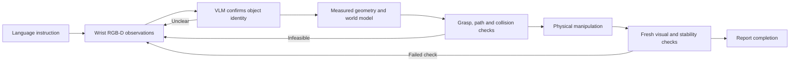

# V3 Studio · See, act, and check

**A simulated Franka Panda that follows a language instruction, uses a vision-language model to confirm the objects, and checks its own work after release.** V3 connects visual understanding to RGB-D geometry, collision-checked motion, physical contact, and recovery in a local, inspectable Studio.

[中文介绍](README.zh-CN.md) · [How the system works](docs/v3-system.md) · [Recorded validation](docs/demo-validation.json)

> **One-sentence demo:** `把青色杯子放到粉色圆柱上边` — confirm the cyan cup and pink cylinder from camera images, grasp and move the cup, release it onto the cylinder, then take new observations to verify the result.


This screenshot is from a complete V3 Studio run using the configured online multimodal model and MuJoCo physics. That run completed with **one grasp, zero recovery attempts, and a successful final check** in approximately 319 seconds. This is one observed task; aggregate task success remains unmeasured.

## How the robot works



**1. Understand what to move and where it should go.** The interpreter extracts the source object, reference objects, spatial relation, and explicit constraints. For “place the cyan cup on the pink cylinder,” both objects must be identified independently. Relations such as right-of, on, and specified edge gaps are converted into conditions that the local validator can check.

**2. Confirm identity from images.** Routine observation uses a simulated wrist RGB-D camera at **640 × 480**. V3 can request a real **1280 × 960** capture and a safer side or oblique view when detail or shape is unclear. A multimodal model compares candidates against the full instruction and records its selected region and visible evidence. Every manipulated object and physical reference requires model confirmation. Local color and depth cues can propose or track candidates, while execution authorization comes from the visual identity evidence.

**3. Measure and plan locally.** Depth, camera calibration, and visible object surfaces provide positions, sizes, and collision geometry. The world model maintains identity, visibility, and measurement freshness separately. Local code generates grasp and placement candidates, solves inverse kinematics, checks the robot and payload against observed obstacles, and executes bounded trajectories. The language model chooses among permitted strategies where applicable. The controller enforces motion and contact constraints.

**4. Manipulate with feedback.** Closing the fingers is followed by bilateral-contact checks, a small probe lift, and a larger lift check. During transport, motion, contact loss, and payload constraints are monitored. The current V3 release controller smoothly clears finger contact promptly and maintains continuous physical friction during release, addressing a reproduced failure in which an upright cup rotated while slowly disengaging from tilted fingers. This behavior applies to verified loaded releases without object-specific names or coordinates.

**5. Verify before reporting success.** The arm releases and retreats, then uses fresh observations to check the requested relation, release state, and stability. Uncertain identity, blocked routes, failed grasps, and rejected final checks lead to bounded observation/replanning or an explicit failure result. VLM confidence alone cannot override a failed geometric or safety check.

## The V3 change from V2

V3 builds on the [V2 project](https://github.com/yejiasong1-ferrari/embodied-agent-v2). Its central change is **mandatory image-based identity confirmation** before manipulation. It also separates temporary occlusion from identity conflict, supports candidate comparison and active side views, and checks identity authorization at skill and motion boundaries. Local RGB-D perception and geometric control remain essential parts of the system. This modular robotics agent uses local geometry and controllers to execute its actions.

The rotatable Studio scene is a **human observer view**. The agent uses its wrist-camera observations, estimated world model, robot proprioception, and contact measurements. Simulator object names and poses are isolated to scene construction and test/evaluation oracles. Regression tests enforce this runtime boundary. See [the system description](docs/v3-system.md) for module links and limitations.

## Run locally

The source and regression suite were verified with **Python 3.12 and MuJoCo 3.14 on macOS**. The Panda model is pinned as a Git submodule.

```bash
git clone --recurse-submodules https://github.com/yejiasong1-ferrari/embodied-agent-v3.git
cd embodied-agent-v3
python3.12 -m venv .venv
.venv/bin/python -m pip install -r requirements-agent.txt
.venv/bin/python run_studio.py --config config/v3.json
```

V3 execution requires a reachable multimodal model configured locally. Credentials are not bundled. The environment template contains placeholders and a public service URL. Offline mode supports development and tests, while strict V3 tasks require visual model confirmation.

Drag the scene to rotate, scroll to zoom, and Shift-drag to pan. The task inspector shows the current skill, observations, recovery events, and final validation. A terminal entry point is also provided:

```bash
.venv/bin/python run_agent.py '把青色杯子放到粉色圆柱上边' --config config/v3.json --required-llm
```

## Tests and evidence

```bash
PYTHONPATH=src .venv/bin/python -m unittest discover -s tests -v
```

The current snapshot passed **347 automated tests**. These cover contracts, strict identity authorization, coordinate handling, world-model continuity, measured geometry, collision checks, grasp/release physics, spatial validation, and Studio behavior. Some tests use protocol stubs, and others use actual MuJoCo dynamics or rendered pixels. Automated test counts do not measure VLM recognition accuracy or task success rates. Rendering/UI tests need a working local graphics environment.

The selected public evidence includes the complete task's [validation summary](docs/demo-validation.json) and the Studio screenshot above. A short [release replay](docs/media/release-replay.mp4) reconstructs the improved release from the recorded trajectory. The replay is a separate physics experiment; the screenshot and validation summary document the complete online run. Original local logs, image archives, credentials, and development history are excluded from this publication.

## Scope and research direction

V3 is a MuJoCo prototype tested on a designed tabletop scene. Recognition errors, occlusion, merged depth components, contact sensitivity, limited tracking, and long observation/planning times remain practical limitations. The project has not been validated on physical hardware or arbitrary unseen objects. The next research directions are more reliable instance tracking, uncertainty-aware active perception, orientation-aware recovery, and broader repeatable evaluation.

Project source is published without a project-wide license, following the author's current choice. Third-party models and dependencies retain their own licenses; see [third-party notices](THIRD_PARTY_NOTICES.md).
