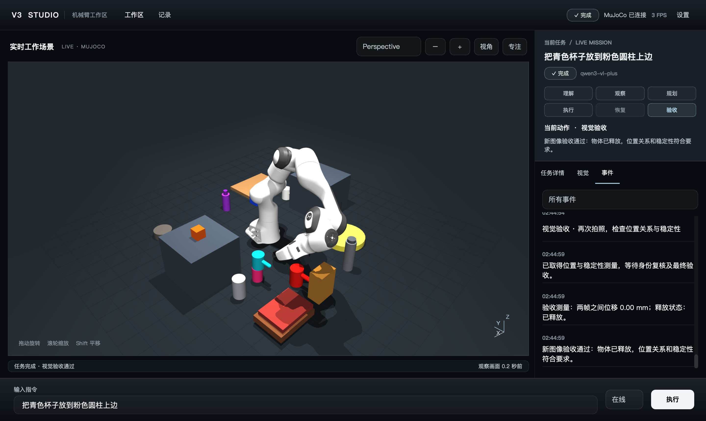
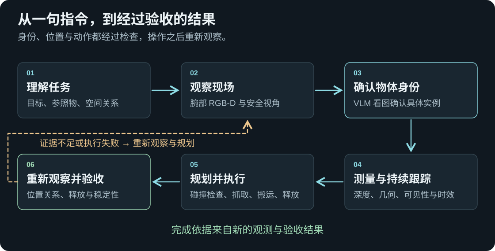
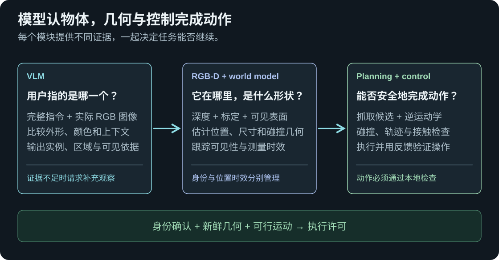
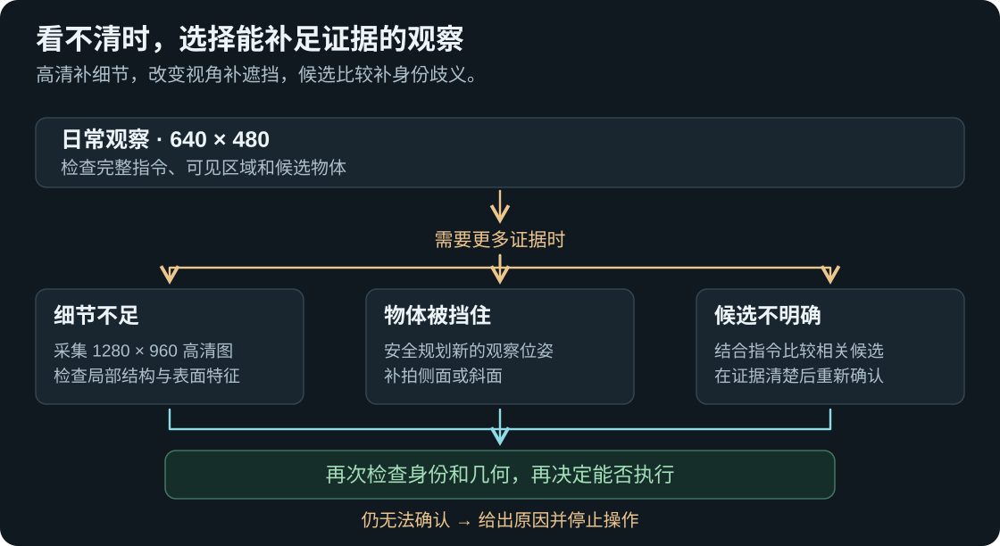
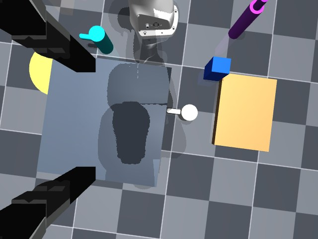
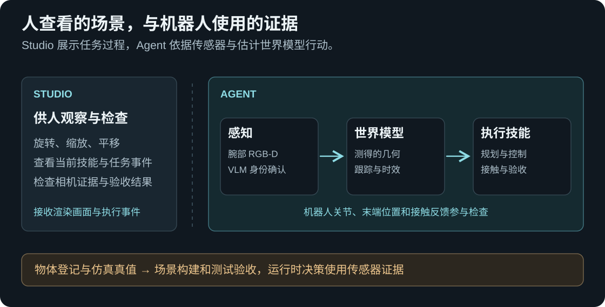

# V3 Studio · 看清目标，完成操作，检查结果

**给模拟 Franka Panda 一句桌面任务，V3 根据相机图片确认物体，规划可行的动作，并在松手之后检查结果。** 完整流程运行在 MuJoCo 中，可以通过本地 Studio 查看。

[English](README.md) · [系统模块与源码地图](docs/v3-system.md) · [实际验收记录](docs/demo-validation.json) · [V2 项目](https://github.com/yejiasong1-ferrari/embodied-agent-v2)

> **一句话演示**　“把青色杯子放到粉色圆柱上边” → 确认两件物体 → 测量和规划 → 抓取并放置 → 松爪、退开、重新验收。

## 先看两段真实任务录像

以下是 **V3 Studio 实际调用在线视觉语言模型、运行 MuJoCo 物理仿真的录屏**。每个任务默认展示 **2 倍速**，展开后可看 **1.5 倍速**；机器人原始执行耗时与视频播放时长分别标注。

### 01 · 把蓝色盒子放到绿色积木右边

V3 根据腕部相机图像确认两件物体，抓起蓝色盒子并规划搬运。途中一次路线受阻，系统恢复后继续放置，最后重新检查“位于右侧”、物体已释放和放置稳定性。

**本次结果：** 抓取 1 次 · 路线恢复 1 次 · 原始执行约 **204 秒** · 最终验收通过。

**2 倍速 · 约 1 分 44 秒**

https://github.com/user-attachments/assets/dd9d4419-6911-4701-ab26-f4b7129a0d33

<details>
<summary><strong>展开观看 1.5 倍速 · 约 2 分 18 秒</strong></summary>

https://github.com/user-attachments/assets/d4148824-34e7-42b8-8aed-364dfb8ac061

</details>

### 02 · 把粉色圆柱放到红色杯子上

V3 补充侧面观察，确认粉色物体的完整外形，并确认红色杯子；随后完成抓取、搬运和叠放。松爪、退开后重新观察，检查圆柱是否保持在杯子上。

**本次结果：** 抓取 1 次 · 失败恢复 0 次 · 原始执行约 **145 秒** · 最终验收通过。

**2 倍速 · 约 1 分 15 秒**

https://github.com/user-attachments/assets/76b157b4-c193-40ee-99eb-f71049a145ae

<details>
<summary><strong>展开观看 1.5 倍速 · 约 1 分 39 秒</strong></summary>

https://github.com/user-attachments/assets/a28ca98c-5ba2-42eb-96a9-b7149f93951f

</details>

[本次任务验收摘要与视频信息](docs/recorded-demos.json) · [全部四个视频版本](https://github.com/yejiasong1-ferrari/embodied-agent-v3/issues/1)

仅裁去成功结果之后、与任务无关的系统停录浮层。观察、规划、恢复、操作及最终验收均按原顺序保留；底部标明播放倍数，原始视频元数据已移除。

<details>
<summary><strong>更早的实例：青色杯子放到粉色圆柱上</strong></summary>



这张图来自 **V3 Studio 中实际运行的 Agent、在线多模态模型和 MuJoCo 物理仿真**。本次任务约 319 秒完成，抓取 1 次、恢复重试 0 次，最终验收通过。[验收记录](docs/demo-validation.json)保存了该次任务的结果摘要，目前尚未建立统计任务成功率。

</details>

V3 在 V2 执行系统上的主要升级，是**把“模型根据现场图片确认物体身份”设为操作前的必要条件**。抓取对象及每个实体参照物，都需要有对应的视觉身份依据。

## 沿着一条指令，理解机器人怎样工作

<picture>
  <source media="(max-width: 860px)" srcset="docs/images/v3-closed-loop-compact-zh.svg">
  
</picture>

**先把指令变成能检查的目标。** 任务理解模块提取要移动的物体、参照物、位置关系和用户明确要求。例如青杯是抓取对象，粉色圆柱是支撑物，“放到上边”需要满足放置与验收的几何条件。

**再确认物体身份，建立实际测量。** 腕部相机提供 RGB、深度和标定信息。能看图的视觉语言模型，简称 **VLM**，结合完整指令确认用户所指的实例。深度处理估计位置与形状，世界模型分别保存身份依据、当前可见性与测量时效。

**用反馈控制完成动作。** 本地程序生成抓取和放置候选，求解逆运动学，检查碰撞与轨迹。夹爪闭合后先检查双侧接触，再小幅试抬，确认物体确实跟随上升。搬运和释放期间继续检查运动与接触状态。

**松手后重新观察，再决定是否完成。** 机械臂退开，为相机留下观察空间。新的观测需要支持用户要求的位置关系、物体已释放和放置稳定。验收失败时，系统可以在预算内重新观察或选择允许的恢复策略。

## 看清模型与本地程序各自负责什么

<picture>
  <source media="(max-width: 860px)" srcset="docs/images/v3-decision-roles-compact-zh.svg">
  
</picture>

VLM 提供**语义身份判断**，说明选中了哪个实例、对应哪块图像区域，以及依据哪些可见特征。颜色与深度可以提出候选、帮助跟踪，明确的属性矛盾也可以否决模型提议。严格 V3 模式下，本地候选本身不能代替模型身份凭据。

RGB-D 提供**位置和形状的实际测量**。规划器与控制器依据这些测量，检查夹爪怎样接近、夹持、搬运和释放。需要模型辅助选择策略时，模型也只能从允许的方案中选择，动作仍受碰撞、接触和验收约束。

因此可以沿记录定位失败发生在哪一层，例如身份不确定、测量过期、抓法或路径不可行、接触丢失，以及最终结果未满足要求。

## 一张图片不够时，怎样补充观察

<picture>
  <source media="(max-width: 860px)" srcset="docs/images/v3-active-observation-compact-zh.svg">
  
</picture>

高清图像用于看清已经可见的小特征。侧面或斜面观察用于露出被挡住的结构，也有助于区分物体轮廓和遮挡边缘。候选比较让模型结合完整指令，对相关备选物体使用一致的判断标准。证据仍不足时，系统会明确报告原因。

<details>
<summary><strong>展开查看这次任务中实际发送给模型的腕部相机图像</strong></summary>



这张原始 640×480 RGB 图片来自本次任务的一次视觉身份请求，展示的是机器人当时的相机视野。上方 Studio 截图则展示较晚的任务结果，使用供人查看的观察相机。[对应的 1280×960 细节图](docs/media/wrist-detail.jpg)。

</details>

## 在 Studio 中检查机器人的工作

<picture>
  <source media="(max-width: 860px)" srcset="docs/images/v3-data-boundaries-compact-zh.svg">
  
</picture>

拖动场景可以旋转，滚轮缩放，Shift 拖动平移。右侧面板展示当前技能、相机证据、恢复尝试和最终验收。人可以自由调整观察角度，机器人仍通过自身标定过的腕部相机获得感知信息。

场景构建、机器人适配、任务逻辑和界面展示分别承担不同职责。回归测试检查运行时是否越过边界，直接查询仿真物体位置。[系统说明](docs/v3-system.md)给出了对应模块和源码入口。

## 核对证据与当前能力边界

- **精选在线任务。** 上方两段[录像对应的记录](docs/recorded-demos.json)包含已通过的身份、新鲜位置关系、释放及稳定性检查。更早的青杯叠放截图有[单独验收记录](docs/demo-validation.json)。这些挑选的成功实例不能代表总体任务成功率。
- **释放物理回归。** [0.2 倍速慢动作](docs/media/release-replay.mp4)根据记录轨迹重建了改进后的释放过程。V3 平滑而及时地脱离手指接触，释放期间保持连续物理摩擦。这是一项独立物理实验，其数据与测试使用真实 MuJoCo 动力学。
- **347 项自动化测试通过。** 覆盖身份授权、坐标处理、跟踪连续性、几何、碰撞、抓取与释放物理、空间约束和 Studio。测试结合模型协议替身、数值检查、物理仿真与渲染图片检查，测试数量不能代表模型识别准确率或统计任务成功率。

V3 目前是在设计的模拟桌面场景中验证的研究原型。识别错误、遮挡、深度组件粘连、接触敏感、跟踪不确定性和较长运行时间仍需改进。实体机械臂及任意新物体上的性能尚未验证。后续工作将聚焦于不确定性驱动的主动观察、实例连续性、物体姿态恢复和更广泛的可重复评估。

## 本地运行

当前快照在 **macOS、Python 3.12 和 MuJoCo 3.14** 环境验证，Panda 模型作为固定版本 Git 子模块提供。严格 V3 执行需要本地可用的多模态服务配置，仓库只包含无凭据的环境模板。

```bash
git clone --recurse-submodules https://github.com/yejiasong1-ferrari/embodied-agent-v3.git
cd embodied-agent-v3
python3.12 -m venv .venv
.venv/bin/python -m pip install -r requirements-agent.txt
.venv/bin/python run_studio.py --config config/v3.json
```

在 Studio 输入 `把青色杯子放到粉色圆柱上边` 即可尝试。命令行入口和回归测试入口为：

```bash
.venv/bin/python run_agent.py '把青色杯子放到粉色圆柱上边' --config config/v3.json --required-llm
PYTHONPATH=src .venv/bin/python -m unittest discover -s tests -v
```

渲染和 UI 测试需要可用图形环境。离线模式用于开发和测试，严格 V3 的物体操作需要模型看图确认。

公开版本排除了实际凭据、专属服务地址、原始本地任务档案、个人电脑路径和旧开发历史。项目原始代码暂不添加整体许可证，第三方组件保留上游许可证，见[第三方说明](THIRD_PARTY_NOTICES.md)。
